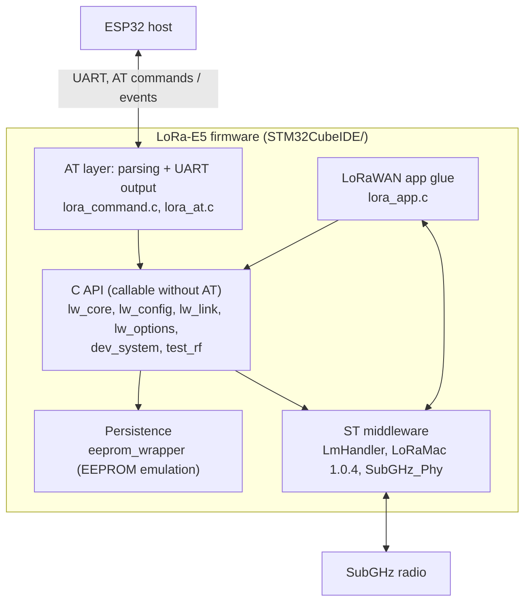

# Architecture

## Layers

- **AT layer** only parses commands and prints responses. All functionality lives in the C API,
  so the same features can be used from C code (e.g. the boot configuration in `main.c`).
- **C API** returns `LW_Status_t` ([lw_types.h](../STM32CubeIDE/LoRaWAN/App/lw_types.h)); every
  public function is Doxygen-documented in its header.
- **Middleware** is the CubeWL `LoRaWAN_AT_Slave` stack, locally patched with weak hooks
  (see [stack-constraints.md](stack-constraints.md)).

## Modules (`STM32CubeIDE/LoRaWAN/App/`)

| Module | Role |
|---|---|
| `lora_command.c` | AT command table, line reception, error printing |
| `lora_at.c` | AT handlers: parameter parsing, calls into the C API, response text, `AT_event_*` outputs |
| `lw_types.h` | `LW_Status_t`, `LW_TxResult_t`, TX/RX callback types |
| `lw_core` | NVM context get/store (`lw_nvm_store()`), mode LWABP/TEST (`lw_mode_set()`, `lw_mode_get()` = LoRaMac stopped), `lw_abp_deactivate()` |
| `lw_config` | Region, DR, channels, class, ADR, power, DC, NET, RX delays, FCnt, keys, DevAddr |
| `lw_link` | `lw_send()`, TX done / RX callbacks, port, retry (confirmed), rept (NbTrans) |
| `lw_options` | Seeed options CT / DUMRX / THLD + strong definitions of the middleware weak hooks |
| `dev_system` | Reset, WDT, log level, UART baud / timeout, low power, RTC |
| `lora_app.c` | LmHandler init, configuration and callbacks |
| `eeprom_wrapper` | `eeprom_vars` (EEPROM emulation) and `ram_vars` (RAM only), see [persistence.md](persistence.md) |
| `demo_funcs` | Demo and debug helpers, not part of the boot: `print_config()` prints the active configuration (reads NVM context, secure element, EEPROM / RAM variables; keys in clear) |
| `test_rf` | AT+TEST mode: RF test functions using the radio directly |

CubeMX code in `STM32CubeIDE/Core/` (`main.c`, `sys_app.c`, `sys_conf.h`, `usart.c`, ...): edit only
inside `USER CODE` blocks.

## Data flow

- **Uplink:** `lw_send()` ([lw_link.c](../STM32CubeIDE/LoRaWAN/App/lw_link.c)) → `LmHandlerSend()` →
  TX done → `OnTxData()` ([lora_app.c](../STM32CubeIDE/LoRaWAN/App/lora_app.c)) → `lw_tx_done()` →
  registered TX-done callback (`AT_msghex_result()` for the AT layer).
- **Downlink:** `OnRxData()` → `lw_rx_done()` → registered RX callback (`AT_event_receive()`).
- **AT command:** UART RX → `CMD_Process()` task → command table → handler in `lora_at.c`.

## Execution model

- Bare metal, cooperative: `main()` loops on `MX_LoRaWAN_Process()` → `UTIL_SEQ_Run()`.
- Sequencer tasks: `LmHandlerProcess` (stack), `Vcom` (`CMD_Process`, AT commands).
- `UTIL_TIMER` callbacks run in the RTC IRQ; low power through `UTIL_LPM` (stop mode when idle).
