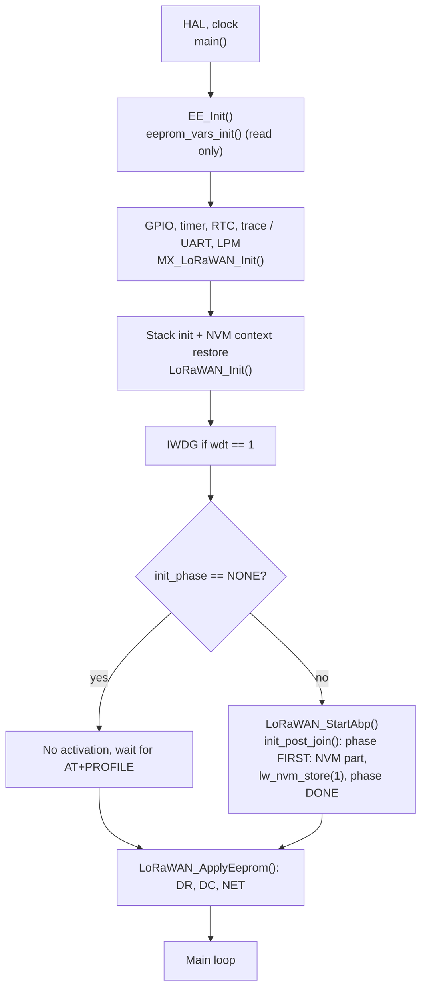

# Boot sequence

The path through the boot is decided by `init_phase` (`EE_VA_INIT_PHASE`, VA 1) in EEPROM
([eeprom_wrapper.h](../STM32CubeIDE/LoRaWAN/App/eeprom_wrapper.h)). The profile the modem is configured with is
stored as profile ID (`EE_VA_PROFILE_ID`, VA 15). Both are copied to `dev_state`
([init_config.h](../STM32CubeIDE/LoRaWAN/App/init_config.h)) by `eeprom_vars_init()`.

| `init_phase` | Meaning |
|---|---|
| 0 `INIT_PHASE_NONE` | Not configured: no data, no valid profile ID, or `AT+PROFILE` interrupted |
| 1 `INIT_PHASE_FIRST` | `AT+PROFILE` stored the profile's EEPROM part; the NVM part is applied at the next boot (or the apply failed and is retried) |
| 2 `INIT_PHASE_DONE` | Configured with the stored profile |

The profile ID is valid only if it is below `PROFILE_COUNT`, otherwise `PROFILE_NONE` (0xFF); without a valid ID
the phase is `INIT_PHASE_NONE` whatever is stored at VA 1. Profiles: [persistence.md](persistence.md).
Nothing is written to EEPROM at boot: only `AT+PROFILE` (`eeprom_profile_write()`) and the AT setters write it.

## Steps

| # | Step | Where |
|---|---|---|
| 1 | HAL, system clock | [main.c](../STM32CubeIDE/Core/Src/main.c) → `main()` |
| 2 | EEPROM emulation init (`Error_Handler()` on failure), then `eeprom_vars_init()` (read only): profile ID (valid if below `PROFILE_COUNT`), `init_phase` (only with a valid ID), `eeprom_vars` = the EE part of the stored profile (`PROFILE_DEFAULT` if none; RAM only), then the stored EE variables overlay it, also when not configured (a missing variable keeps the profile value) | `main()` (USER CODE SysInit) → `EE_Init()`, [eeprom_wrapper.c](../STM32CubeIDE/LoRaWAN/App/eeprom_wrapper.c) → `eeprom_vars_init()` |
| 3 | GPIO, then UTIL_TIMER + RTC, debug pins, trace / UART (baud from `eeprom_vars`), measurements, low power manager; trace level OFF | `MX_GPIO_Init()`, [app_lorawan.c](../STM32CubeIDE/LoRaWAN/App/app_lorawan.c) → `MX_LoRaWAN_Init()` → `SystemApp_Init()` ([sys_app.c](../STM32CubeIDE/Core/Src/sys_app.c)) |
| 4 | LoRaWAN stack init: sequencer tasks, `LmHandlerInit()`, `LmHandlerConfigure()` (NVM context restore, DC / NET / DR defaults), AT callbacks, `LoRaMacStart()` if the MAC is still stopped (LWABP = MAC running) | [lora_app.c](../STM32CubeIDE/LoRaWAN/App/lora_app.c) → `LoRaWAN_Init()` |
| 5 | `dev_log_set(VLEVEL_H)` if `DEBUGGING == 1` (`sys_conf.h`), so the `DEBUG_PRINTF` lines are visible | `main()` (USER CODE 2) |
| 6 | IWDG, if `eeprom_vars.wdt == 1` | `main()` → `MX_IWDG_Init()` |
| 7 | Boot autoconfiguration, see below | [auto_init.c](../STM32CubeIDE/LoRaWAN/App/auto_init.c) → `auto_init_run()` |
| 8 | Main loop: `MX_LoRaWAN_Process()` → `UTIL_SEQ_Run()` | `main()` |

## Step 7: `auto_init_run()`

The device identity (AppSKey, NwkSKey, DevAddr) is not set at boot and the region is the compile-time
`ACTIVE_REGION` (EU868, [lora_app.h](../STM32CubeIDE/LoRaWAN/App/lora_app.h)). Keys and DevAddr come from the NVM
context restored in step 4.

- **`INIT_PHASE_NONE`:** no activation, the modem waits for AT commands (`AT+PROFILE`).
- **Otherwise:** `LoRaWAN_StartAbp()` (no-op when activated), then `init_post_join(&profiles[profile_id])`:
  `while (LoRaMacIsBusy()) MX_LoRaWAN_Process();`, then
  - `INIT_PHASE_DONE`: return;
  - `INIT_PHASE_FIRST`: the profile's NVM part: 16 channels (`lw_ch_set()`, or `lw_ch_disable()` for
    frequency 0), class, ADR, power (FORCE), RX1 / RX2 delay, rept; then `lw_nvm_store(1)` (forced: it also
    stores the activation) and `init_phase = INIT_PHASE_DONE`. The first failing step returns; the phase stays
    FIRST and the apply is repeated at the next boot.
- **Every boot, last:** `LoRaWAN_ApplyEeprom()` (lora_app.c): DR, DC, NET from `eeprom_vars` into the stack
  (`LmHandlerConfigure()` resets them); no EEPROM write. Everything else, including AT overrides made after the
  profile, stays.
- The EEPROM part of the profile has no apply step: `eeprom_profile_write()` stores it and the code reads
  `eeprom_vars`. CT is therefore already set when the channels are set (`lw_ch_set()` accepts out-of-band
  frequencies only with CT OFF). LDRO is stored only. UART baud and WDT take effect after a reset.
- RX2 data rate and frequency are not part of a profile and cannot be set over AT (the commands were removed).

## Setting a profile: `profile_set()` / `AT+PROFILE`

`profile_set()` (auto_init.c) refuses: a profile that does not exist, TEST mode, a busy MAC and, when not
activated, a DevAddr that is 0 or equal to the chip-UID default (`GetDevAddr()` in sys_app.c, which
`LmHandlerConfigure()` fills in when none is set), i.e. not set by `AT+ID` (the keys are not checked). Then `eeprom_profile_write()`:
`init_phase = NONE`, `eeprom_vars` = the profile's EE part, the 13 EE variables, the profile ID, `init_phase = FIRST` last
(only if all writes succeeded; an interrupted write leaves the module not configured). It applies nothing to the
stack. `AT+PROFILE` then resets the module (`dev_reset()`) and the next boot applies the NVM part. AT setters
used before `AT+PROFILE` are overwritten by the profile.

**New module (host flow):** `AT+ID=DevAddr,...`, `AT+KEY=NWKSKEY,...`, `AT+KEY=APPSKEY,...` (accepted because the
module is not activated; each stores the NVM context at once), then `AT+PROFILE=<n>`. The same `AT+PROFILE` switches the profile on a configured
module. How the identity reaches flash: [persistence.md](persistence.md).
At the boot after `AT+PROFILE` on a new module the context was stored not activated, so the stack counts it as not
restored (`CtxRestoreDone` false) and `LmHandlerJoin(ABP)` runs the first activation (MLME join, class reset to
class A); `init_post_join()` waits for it (`LoRaMacIsBusy()`) before applying the profile. Keys and DevAddr are
still restored. On a configured module the restored context is activated and no join runs.

**Module from an older firmware:** `init_phase` 2 without a profile ID is phase NONE (not configured). Its
restored NVM context is activated and the stack restarts the MAC itself, so the module keeps working; the host
sends `AT+PROFILE` once.

A module with a lost NVM context and phase FIRST / DONE is activated with the stack's default keys
([known-issues.md](known-issues.md)).

## Paths

