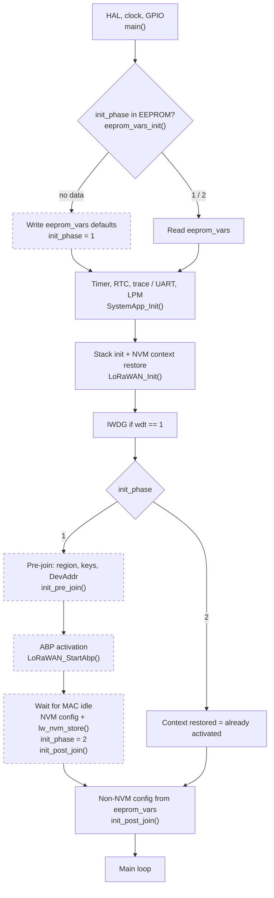

# Boot sequence

The path through the boot is decided by `init_phase`, stored in EEPROM (`EE_VA_INIT_PHASE`, VA 1,
[eeprom_wrapper.h](../STM32CubeIDE/LoRaWAN/App/eeprom_wrapper.h)):

| `init_phase` | Meaning |
|---|---|
| no data | Very first boot: EEPROM empty |
| 1 | EEPROM defaults stored, stack not configured yet (also: a phase-1 boot failed and is repeated) |
| 2 | Fully configured: configuration in the NVM context |

## Steps

| # | Step | Where | No data | 1 | 2 |
|---|---|---|---|---|---|
| 1 | HAL, system clock, GPIO | [main.c](../STM32CubeIDE/Core/Src/main.c) → `main()` | ✔ | ✔ | ✔ |
| 2 | EEPROM emulation init; write `eeprom_vars` defaults, `init_phase = 1` (marker last, only on success) | `EE_Init()`, [eeprom_wrapper.c](../STM32CubeIDE/LoRaWAN/App/eeprom_wrapper.c) → `eeprom_vars_init()` → `eeprom_vars_write_all()` | ✔ | – | – |
| 2' | Read `eeprom_vars` from EEPROM (missing variable keeps its default) | `eeprom_vars_init()` | – | ✔ | ✔ |
| 3 | UTIL_TIMER + RTC, debug pins, trace / UART, measurements, low power manager; trace level OFF | [app_lorawan.c](../STM32CubeIDE/LoRaWAN/App/app_lorawan.c) → `MX_LoRaWAN_Init()` → `SystemApp_Init()` ([sys_app.c](../STM32CubeIDE/Core/Src/sys_app.c)) | ✔ | ✔ | ✔ |
| 4 | LoRaWAN stack init: sequencer tasks, `LmHandlerInit()`, `LmHandlerConfigure()` (NVM context restore, DC / NET defaults), AT callbacks, `LoRaMacStart()` if the MAC is still stopped (LWABP = MAC running) | [lora_app.c](../STM32CubeIDE/LoRaWAN/App/lora_app.c) → `LoRaWAN_Init()` | ✔ | ✔ | ✔ |
| 4' | `dev_log_set(VLEVEL_H)` if `DEBUGGING == 1` (`sys_conf.h`), so the `DEBUG_PRINTF` lines of the config functions are visible from here on | `main()` | ✔ | ✔ | ✔ |
| 5 | IWDG, if `eeprom_vars.wdt == 1` | `main()` → `MX_IWDG_Init()` | ✔ | ✔ | ✔ |
| 6 | Pre-join config: region EU868, AppSKey, NwkSKey, DevAddr (defaults from `ram_vars`) | `main.c` → `init_pre_join()` | ✔ | ✔ | skipped |
| 7 | ABP activation (only if not activated; with a restored context nothing happens) | `LoRaWAN_StartAbp()` | ✔ | ✔ | no-op |
| 8 | Wait until the MAC is idle (`while (LoRaMacIsBusy()) MX_LoRaWAN_Process();`), then NVM config: channels (`ram_vars.ch_data`), class, ADR, power, RX1 / RX2 delay, rept → `lw_nvm_store()` → `init_phase = 2` | `main.c` → `init_post_join()` | ✔ | ✔ | skipped |
| 9 | Non-NVM config from `eeprom_vars` (all phases): DR, DC, NET, THLD, CT, PORT, RETRY. LDRO and DUMRX are commented out; RX1 / RX2 windows are not applied | `init_post_join()` | ✔ | ✔ | ✔ |
| 10 | Main loop: `MX_LoRaWAN_Process()` → `UTIL_SEQ_Run()` | `main()` | ✔ | ✔ | ✔ |

If `init_post_join()` cannot read `init_phase` from EEPROM, or any step fails, it returns early and the
remaining steps are skipped (see [known-issues.md](known-issues.md)).

"No data" continues as phase 1 in the same boot: step 2 sets `init_phase = 1` before step 6 reads it.
If a phase-1 step fails, the function returns early, `init_phase` stays 1 and the boot repeats the
configuration next time.

## Paths

Dashed: only when `init_phase` is 1 (or no data).

